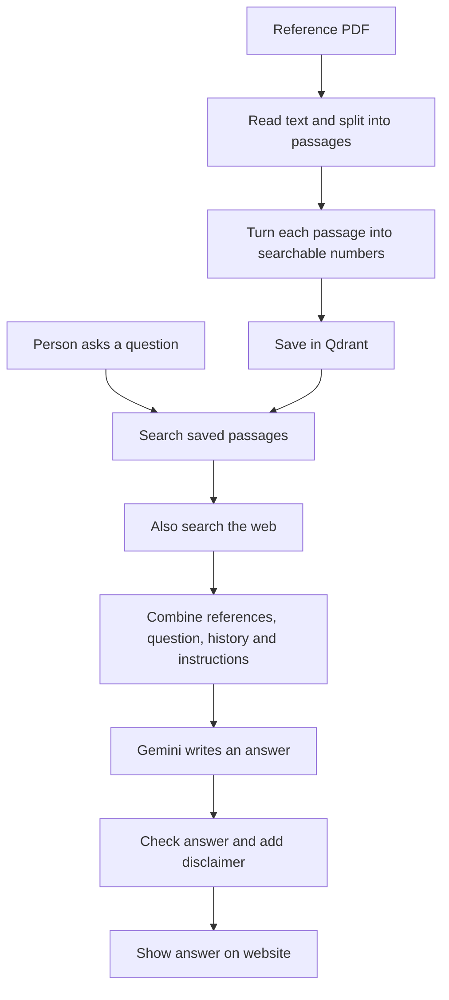

# How the AI finds information and answers

NatureCure AI searches reference material before asking Gemini to write an answer. This approach is called **RAG**, short for retrieval-augmented generation. In plain language: find useful information, give it to the AI, and ask the AI to answer using it.

This guide describes the code reviewed on 2026-10-28. The review did not run searches or contact AI services. It does not prove that the current credentials, online services, or saved references work.

For the rest of the app, see [how the app works](architecture.md). For startup and tests, see [the development guide](development-guide.md).

## The flow at a glance

There are two separate jobs:

1. **Prepare references:** read PDFs, split them into small passages, and make them searchable.
2. **Answer questions:** search those passages and the web, then send the useful text to Gemini.

Qdrant is the search store. Gemini is Google's AI. The app connects these services; Qdrant itself does not call Gemini.

## 1. Preparing reference documents

The code calls this **ingestion**, meaning loading documents into the search store.

A PDF can be placed in `backend/data/docs/` or uploaded by a signed-in admin. The shared loading code is `backend/ingest_docs.py`.

### What happens to a PDF?

1. The app reads the text on each page using a library called pypdf.
2. It splits the text into passages of about 800 characters. Neighbouring passages share 150 characters so an idea is less likely to be cut off completely.
3. It records the filename, page, title, and category with each passage.
4. It sends groups of 100 passages to the embedding step described below.
5. It saves the searchable results in Qdrant and records how much work is complete.

A scanned book may contain only pictures of pages. The app does not currently turn those pictures into text, a process called OCR. A PDF with no readable text fails loading.

### Can loading resume after a failure?

Yes. The app keeps a progress record named `DocumentIngestion` in the main database. It updates progress after Qdrant confirms a group was saved.

Each file version has a fingerprint, or hash. Each passage also has a repeatable ID based on the filename, fingerprint, and passage position. Sending the same passage again updates its existing entry rather than creating another copy.

When replacing a document, the old version remains searchable until the new version finishes. During that time, searches may find both old passages and newly loaded passages. The search does not choose only the completed version.

Developers will find SHA-256 file fingerprints and UUID5 passage IDs in `backend/ingest_docs.py`. Its calls go to `add_document_chunks` in `backend/rag/qdrant_store.py`; that helper can process up to 200 texts at once, while PDF loading supplies batches of 100.

### How does the admin screen follow progress?

The signed-in admin starts loading through POST `/api/admin/ingest/{filename}`. A background task works while the website asks GET `/api/admin/docs` for progress. Work interrupted by a server restart can be shown as interrupted and resumed.

The running server tracks its own jobs. There is no shared job manager coordinating multiple servers. Uploads check the file extension, clean the filename, and use a temporary file while saving. Replacing different content under the same name requires a replacement request.

Older stored passages have checks that try to recognise work done before progress tracking existed. Those checks compare counts, fingerprints, and text where appropriate.

### What about the JSON reference files?

`backend/knowledge_base/` contains organised reference files in JSON, a computer-readable text format. Their loading script, `backend/scripts/seed_kb_to_qdrant.py`, currently points to the wrong folder. The Makefile also points to the wrong script location.

The script needs better passage sizes and repeatable IDs before it is a reliable loading process. Files being present in the repository does not prove that they are searchable in Qdrant.

## 2. Making text searchable by meaning

An **embedding** is a list of numbers representing text. The app asks Google's embedding model to make these lists for both reference passages and questions. Qdrant compares the lists to find passages that may have a similar meaning, even when their wording differs.

The implementation is in `backend/rag/qdrant_store.py`:

- It names the model `models/gemini-embedding-001` and expects 3072 numbers per passage.
- It uses cosine similarity, a way of comparing these number lists.
- It always uses the API-key connection for embeddings, even if answer writing uses Vertex AI.
- It stores text, source, page, title, category, file fingerprint, and document ID alongside the numbers.
- It does not explicitly tell the model whether the text is a document or a search question through embedding task types.

Qdrant can run as an online service or use files on the local computer. Test mode can use temporary memory. In normal development or production, if another process has locked the local Qdrant files, the operation stops with an error. This prevents the system from reporting success after writing vectors only to temporary memory.

The code slows document loading and retries some quota errors to reduce pressure on the embedding service. A quota is a provider's limit on use. Question searches use shorter retries. Some repeated question embeddings are saved for reuse.

## 3. Receiving a question

The normal website uses these steps:

1. Start a conversation with `/api/naturo/start`. The welcome message itself does not need an AI call.
2. Send a question to `/api/naturo/chat` with the conversation ID.
3. Load the saved conversation and check sign-in if Treatment Mode is being used.
4. Check the message against certain emergency and unrelated-topic words.
5. If blocked, return a fixed message without calling the AI. Otherwise continue to search and answer.

Age is checked when a conversation starts. Pregnancy words can produce warnings, but those warnings are not consistently carried into later steps. The treatment form has a separate submission path and does not run all these conversation checks.

Sign-in checks do not currently prove that the supplied conversation ID belongs to the person using it.

Source files: `backend/main.py`, `backend/guardrails/input_guardrails.py`, and `backend/naturopathy/agent.py`.

## 4. Finding useful reference material

The app searches using the latest user message. It does not first rewrite that message using the whole conversation. A short follow-up such as an age alone can therefore be a weak search question.

`backend/rag/hybrid_retriever.py` does two searches, one after the other:

1. Ask Qdrant for the top three passages.
2. Ask web search for up to two results.

This is called **hybrid retrieval** here because it combines saved references and web results. It does not include a separate keyword-search system or a second AI that rearranges results by relevance.

There is no minimum match score. Even the best three available passages may not be useful enough for the question.

### Are web results limited to approved websites?

Not reliably yet. `backend/rag/web_search.py` builds a search using websites listed in `backend/resources.yaml`. If that finds nothing, it tries a broader search without that restriction. It does not independently check each returned website address against the approved list.

The code labels the results as authentic references, but that label is not proof that they came from an approved website.

### What happens if search fails?

Search errors often become empty results. The app can still ask Gemini to answer without reference material. This does not meet the intended rule that remedies must come from approved references.

The app also keeps up to 128 recent combined search results in a cache, meaning saved results reused for speed. These do not have a time limit and are not cleared automatically after document changes. An empty result caused by a failure can therefore be reused later.

## 5. Asking Gemini to write the answer

A **prompt** is the set of instructions and information sent to an AI. For a normal question, the app combines:

- General instructions about its role.
- Question Mode instructions about the answer format and follow-up question.
- Passages and web snippets found by search.
- The conversation history.

Gemini receives this material and writes a response. A greeting uses simpler instructions and leaves out the reference text, although search has already happened. Profile details are not consistently included when there is already a user message in the history.

`backend/naturopathy/prompts.py` contains the instructions. `nodes.py` makes the model calls. `graph.py` connects the steps using LangGraph, a library that runs a workflow as named steps.

The normal question path is `qdrant_query -> intake -> END`: search, answer, finish this turn. The step named intake handles both question answers and the chat-based collection of treatment details.

Answer writing can use the Gemini API or Vertex AI, Google's cloud connection. The API-key path tries alternative model names after failures. That does not prove those models are currently available. Settings control model choice, answer length, and variation; their values are not copied here.

Saved AI answers can be reused through Redis or temporary memory. The code also cleans different response formats and removes think blocks before returning the final answer. The model calls inside each step wait for their result; the two searches are not run in parallel.

### How does it suggest Treatment Mode?

The AI is asked to add the exact marker `[MODE: treatment]` when it recommends further assessment. The code removes that marker from the visible text and sends a separate mode suggestion to the website.

This depends on the AI following instructions. The current prompt can give remedies while making that suggestion, although the intended behavior is to leave serious-case remedies to a practitioner. Follow-up question suggestions mostly come from fixed lists selected by topic words.

## 6. The separate treatment paths

### Form submission

The three-screen treatment form is saved directly for practitioner review. `/api/naturo/submit_intake` does not run the AI analysis below.

### Chat-based analysis

After eight recorded answers, the treatment conversation can run these steps:

| Code step | What it asks the AI to do |
|---|---|
| `root_cause_node` | Suggest possible underlying causes from answers and history |
| `medical_triage_node` | Search again using those causes and suggest actions |
| `recommendation_node` | Turn the suggested causes and actions into a report |
| `guardrail_output_node` | Check certain emergency words, set some referral flags, and add a disclaimer |

Despite the medical-sounding name, `medical_triage_node` selects suggested actions; it is not a separate reliable medical decision system. The final report writer does not receive the reference passages again directly.

The app asks for JSON so it can read lists and report fields. It removes formatting and tries to read the result. If that fails, it records an error and may use empty lists or an empty report. Defined report models are not used to fully validate each AI result. There is no explicit plan for shortening long conversations to fit the AI's input limit.

### Practitioner AI tools

The practitioner can add an instruction and rerun the conversation workflow to help draft a plan. If the live conversation has expired, the code rebuilds part of it from the saved case. This depends on how the intake step handles that rebuilt information and needs a running test.

There is also an admin reference-search tool at `/api/admin/embeddings/search-with-answer`. It searches Qdrant and asks the Google client to answer from those passages. It has its own retries and error handling rather than using the normal chat workflow and safety checks.

## 7. Showing and checking the answer

The normal chat route checks the answer for certain conventional-medication words. A match can replace the whole answer with a refusal. It then adds a disclaimer.

Some calculated referral warnings are not copied back into conversation state. The saved transcript may also retain the earlier answer instead of the checked version. A disclaimer does not establish that the advice is correct.

The website receives the complete answer and related fields through `AssessmentResponse` in `backend/naturopathy/schemas.py`. It shows formatted text or builds cards using `frontend/src/lib/parseRemedyContent.js`. Card parsing can shorten content or insert default advice. Safety warnings arrive as a list, while the alert display expects a different format.

Reference names and addresses are included inside the AI's instructions, but there is no separate list of sources in the answer contract. A citation feature has been deferred.

### Piece-by-piece answers

An optional streaming route, `/api/naturo/chat_stream`, sends answer pieces as they appear. It uses server-sent events, or SSE. The main chat screen currently uses the complete-answer route instead.

Streaming has unfinished safety handling: pieces can leave the server before the final answer check, and pieces from intermediate AI steps are not limited to the final answer. The browser's stream reader can also catch and hide some error messages.

## Where developers can look next

| Area | Files |
|---|---|
| Conversation and streaming | `backend/naturopathy/agent.py`, `graph.py`, `state.py` |
| Prompts and AI calls | `backend/naturopathy/prompts.py`, `nodes.py` |
| Search and embeddings | `backend/rag/hybrid_retriever.py`, `qdrant_store.py`, `web_search.py` |
| Document progress | `backend/ingest_docs.py`, `backend/database/models.py` |
| Safety checks | `backend/guardrails/input_guardrails.py`, `output_guardrails.py` |
| Website connection and display | `frontend/src/services/api.js`, `frontend/src/components/ChatInterface.jsx` |

## What remains uncertain or incomplete?

Tests usually replace real AI and search with pretend results. Document tests also use fake services. They check application behavior, but do not establish real answer quality or reference accuracy.

The review did not check model support, service limits, credentials, current Qdrant contents, or real search results. Important unfinished work includes enforcing approved sources, handling search failures visibly, filtering weak matches, improving follow-up searches, checking AI report structure, coordinating document jobs across servers, and making streaming safe.
