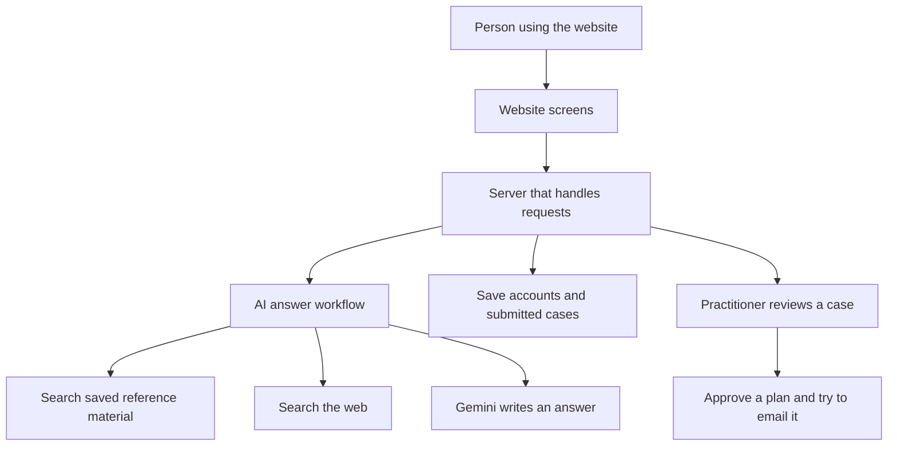

# How NatureCure AI works

This guide explains the app from a user's point of view, then shows where its main parts live in the code. It describes the code reviewed on 2026-10-28, including changes that have not been committed to Git. The app and its online services were not run during this review.

## The big picture

NatureCure AI lets a person ask health questions and submit their details for a practitioner's review. A practitioner is the person who reviews a case and approves a treatment plan.

There are two main ways to use the app:

- **Question Mode:** ask a question without signing in. The app looks for reference material and asks Google's Gemini AI to write an answer.
- **Treatment Mode:** sign in, complete a form, and submit it for review. A practitioner can prepare and approve a plan. The patient can then read it in their case history.

The intended rule is that serious problems should go to a practitioner without the AI giving remedies. The current code does not fully enforce that rule: it can give advice while suggesting Treatment Mode.

For a closer look at how the AI searches and answers, read [the AI guide](ai-rag-pipeline.md). To run the project, read [the development guide](development-guide.md).

## What happens when someone asks a question?

1. The website starts a conversation and gives it an ID.
2. The person sends a message.
3. The server checks for certain emergency words, unrelated topics, and some age restrictions.
4. It searches saved reference material and the web.
5. Gemini receives the question, conversation history, instructions, and search results.
6. The server checks the answer for certain medication words and adds a disclaimer.
7. The website shows the answer as text or remedy cards.

These checks mostly look for words and phrases. They are not a complete medical assessment.

The main chat currently waits for a complete answer. Code for showing an answer piece by piece exists, but the main chat screen does not use it.

## What happens when someone submits a case?

The person signs in and completes a form with three screens. Submitting it saves the answers for review; it does not ask the AI to analyse them at that point. The person is then taken to their case history.

The practitioner can read the case, use a saved template, write a draft, ask the AI for help, and approve a plan. Approval is saved before the app tries to send an email. If email is unavailable, the app can save an email-shaped HTML file on the server instead. This does not mean an email reached the patient.

There is also a separate chat-based treatment path. It starts AI analysis after eight recorded answers. Those are conversation entries, not necessarily eight complete form fields.

## The main parts of the app

The **frontend** is the website people see. It uses Next.js and React. The **backend** is the server that handles sign-in, searches, AI requests, and saved records. It uses FastAPI and Python. An **API** is the set of addresses the website calls to ask the server to do something.

| Part | What it does | Important source files |
|---|---|---|
| Home and chat | Starts conversations and displays answers | `frontend/src/app/page.js`, `frontend/src/components/ChatInterface.jsx` |
| Case history | Shows submitted cases and plans | `frontend/src/app/history/page.js` |
| Practitioner area | Handles review, templates, and documents | `frontend/src/app/admin/page.js`, `frontend/src/components/admin/AdminDashboard.jsx` |
| Website/server connection | Sends requests and receives results | `frontend/src/services/api.js` |
| Server entry point | Connects the main server features | `backend/main.py` |
| Sign-in | Checks patient and admin access | `backend/auth/`, `backend/admin/router.py` |
| AI workflow | Decides which AI steps run | `backend/naturopathy/` |
| Reference search | Finds book passages and web results | `backend/rag/` |
| Document loading | Makes PDFs searchable | `backend/ingest_docs.py` |
| Saved records | Defines accounts, cases, and document progress | `backend/database/models.py` |
| Live conversations | Keeps an unfinished conversation available | `backend/memory/session_store.py` |
| Email | Sends or saves the approved plan | `backend/utils/mailer.py` |

## Where information is kept

| Storage | Plain-language purpose | Current limitation |
|---|---|---|
| PostgreSQL | Saves accounts, profiles, submitted cases, templates, and document progress | The app can switch to a local SQLite database if connection fails |
| Redis | Keeps active conversations and saved AI answers for reuse | It can switch to the running server's memory, which is lost on restart |
| Qdrant | Holds searchable reference passages and their number-based representations | Local storage problems can cause a switch to empty temporary storage |
| Browser storage | Remembers profile details and unfinished forms on that browser | Saved health details are not consistently cleared on logout |

Redis conversations normally expire after an hour. The temporary memory replacement does not apply the same expiry. These automatic replacements can make the app appear to work while information is missing or stored somewhere unexpected.

Starting the server can create database tables, add missing fields, and add starter templates. There is no organised Alembic change history yet; Alembic is a tool for tracking database structure changes.

## Sign-in and access

Patient passwords are stored as protected hashes, rather than readable passwords. After sign-in, the browser keeps a signed login token in a cookie. Admin login uses a separate cookie and configured credentials.

Some access checks are missing. Saved case pages check which patient owns the case, but live conversation read/delete routes do not require sign-in. Chat and form submission also do not check that a conversation belongs to the person using it. These are existing gaps, not intended behavior.

## Request addresses for developers

GET reads information, POST submits an action, PUT updates it, and DELETE removes it.

| Address group | Available actions |
|---|---|
| `/api/auth` | Sign up, log in, log out, get current user |
| `/api/naturo` | Start/chat, optional streaming chat, submit form, read history, read/delete a case |
| `/api/session/{id}` | Read/delete a live conversation |
| `/api/admin` | Admin login, document management, pending cases, drafts, approval, AI help, templates |
| `/api/admin/embeddings` | Search reference passages, optionally generate an answer |
| `/health` | Returns a basic success response; does not test connected services |

Patient case addresses use a case number. Practitioner case addresses use the conversation's unique ID. The full route definitions are in `backend/main.py`, `backend/auth/router.py`, and `backend/admin/router.py`.

The website sends complete data messages called JSON and includes login cookies. Its server address comes from `NEXT_PUBLIC_API_URL`. A separate forwarding route exists in `frontend/next.config.js`, but the main website client calls the backend directly.

## What still needs work?

- Failed searches can still lead to answers without reference material.
- The web search can return websites outside the approved list.
- Some safety warnings are not passed through or displayed correctly.
- The website can substitute example replies when a server request fails, hiding the failure.
- A failed case save can still be followed by a success message.
- Patients may receive a saved prescription draft before approval.
- Login cookie settings need checking when website and server use different domains. Default admin credentials are not rejected automatically.
- The piece-by-piece answer route can send text before the final safety check.
- Some errors reveal internal details. There is no complete activity audit, reliable background job service, or automatic test process on code changes.

Ayurveda, homeopathy, additional languages, WhatsApp, ABDM, and telemedicine are listed as future work rather than implemented services.

## What has not been checked?

The review did not check live hosting, credentials, model availability, actual reference-store contents, email delivery, or passing test counts. Hosting files and `docs/DEPLOYMENT.md` describe a proposed Vercel/Render/Neon/Qdrant Cloud setup, not proof that it currently works. Older documents may describe earlier code.
